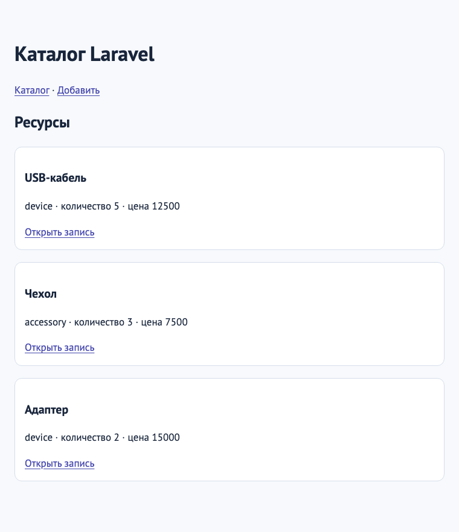
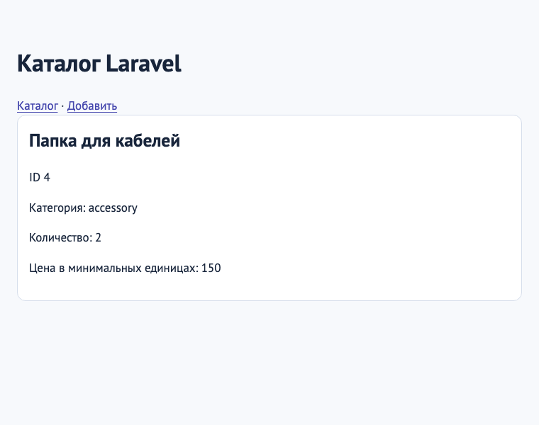
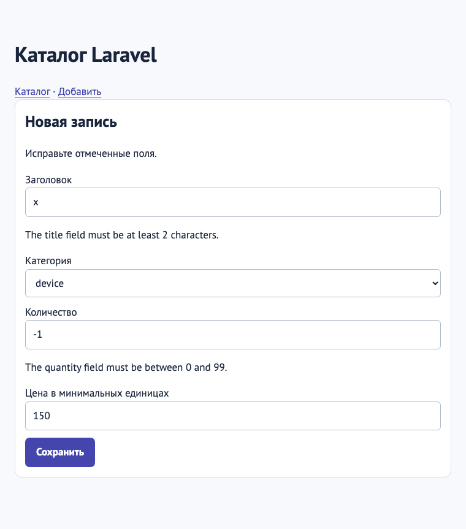
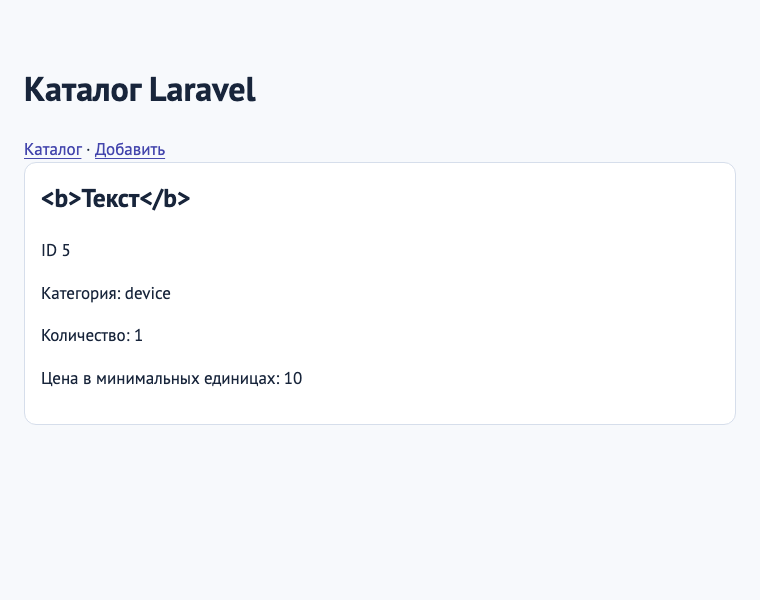
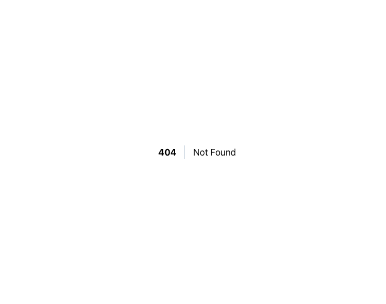
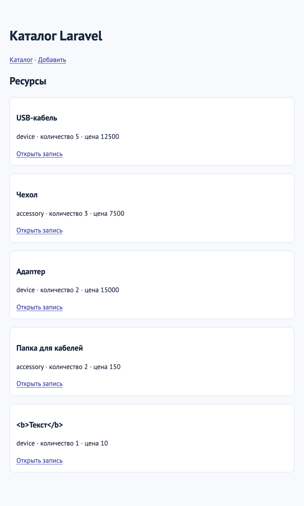

# Дополнительное задание к практической работе № 6: каталог на Laravel

**Студент:** группа CS-302(С)
**Вариант:** A (техника, категории `device` и `accessory`)

Отдельный проект Laravel 13 с собственной БД `p06_laravel`: список ресурсов, карточка записи и форма добавления с проверкой полей. Основной каталог № 6 и его база не затрагиваются.

## Среда

| Компонент | Версия |
|---|---|
| PHP | 8.4.11 |
| Composer | 2.8.1 |
| Laravel | 13.42.0 |
| Сервер БД | MySQL 9.4.0 |
| Адрес | http://localhost:8081/ |
| Веб-корень | `catalog-laravel/public` |

## Запуск через Uniform Server

1. Проверить PHP CLI (8.3+) и расширения `ctype`, `curl`, `dom`, `fileinfo`, `mbstring`, `openssl`, `pdo_mysql`, `session`, `tokenizer`, `xml` командой `php -m`.
2. Установить зависимости и создать локальный `.env`:
   ```powershell
   composer install --no-dev
   Copy-Item .env.example .env
   php artisan key:generate
   ```
3. В phpMyAdmin создать отдельную БД `p06_laravel` (`utf8mb4_unicode_ci`). В `.env` указать свои `DB_USERNAME` и `DB_PASSWORD` вместо `REPLACE_WITH_LOCAL_…`; остальные параметры уже заданы: `DB_CONNECTION=mysql`, `DB_DATABASE=p06_laravel`, `APP_URL=http://localhost:8081`, `APP_DEBUG=false`, `SESSION_DRIVER=file`, `CACHE_STORE=file`, `QUEUE_CONNECTION=sync`. Затем `php artisan config:clear`.
4. В конфигурацию Apache, где описан VirtualHost основного каталога, добавить блок из `apache-laravel.conf` (заменить оба пути на фактическую папку проекта), перезапустить Apache и открыть http://localhost:8081/up — ожидается 200.
5. Создать таблицу и исходные записи:
   ```powershell
   php artisan migrate
   php artisan db:seed --class=ItemSeeder
   php artisan migrate:status
   php artisan route:list --path=items
   ```
6. Открыть http://localhost:8081/items.

`.env`, `vendor/`, журналы `storage/logs` и APP_KEY в репозиторий не входят.

## Что сделано

| Файл | Назначение |
|---|---|
| `app/Models/Item.php` | модель Eloquent для таблицы `items`; `$timestamps = false`; `$fillable` — `title`, `category`, `quantity`, `price_minor`; приведение количества и цены к `int` |
| `app/Http/Controllers/ItemController.php` | `index()` — `Item::orderBy('id')->get()` в шаблон `items.index`; `show(Item $item)` — карточка (нет записи — 404); `create()` — форма с категориями варианта A; `store()` — `validate()` (заголовок 2–80, `Rule::in(['device','accessory'])`, количество 0–99, цена 0–999999), `Item::create($data)` только из проверенных данных, 303 на карточку |
| `routes/web.php` | `/` → `/items`; `items.index`, `items.create` (`/items/new`), `items.show` (`/items/{item}`, только число), `items.store` (POST) |
| `resources/views/layout.blade.php`, `items/*.blade.php` | общий макет, список (`@forelse`), карточка, форма (`@csrf`, `old()`, `@error`); весь вывод через экранирующий `{{ … }}` |
| `database/migrations/2026_11_01_000100_create_items_table.php` | таблица `items`: `id`, `title` (80), `category` (24), `quantity`, `price_minor` |
| `database/seeders/ItemSeeder.php` | три записи варианта A: USB-кабель, Чехол, Адаптер |
| `public/p06.css`, `public/p06-fonts/` | оформление и шрифты из комплекта |
| `.env.example`, `apache-laravel.conf` | образец настроек MySQL без паролей и VirtualHost на порту 8081 |

Категории в `ItemSeeder`, `create()` и `Rule::in()` совпадают с вариантом A, поэтому исходники комплекта перенесены без изменения логики.

### Путь запроса `GET /items`

`routes/web.php` (`Route::get('/items', [ItemController::class, 'index'])->name('items.index')`) → `ItemController::index()` → модель `Item` (имя класса `Item` → таблица `items`) → `SELECT` через соединение MySQL из `.env` → `view('items.index', ['items' => …])` → `@forelse($items as $item)` и `{{ $item->title }}` в Blade → HTML-ответ 200.

| Основной каталог № 4–6 | Laravel |
|---|---|
| `Router::add()` в `p05-routes.php` | `Route::get()/post()` в `routes/web.php` |
| `ItemController` / `AccountCatalogController` | `App\Http\Controllers\ItemController` |
| `PdoItemRepository` (SQL с PDO) | модель Eloquent `Item` |
| `sql/schema.sql`, `variant_A.sql` | миграция и `ItemSeeder` |
| `ItemData::from()` + `HttpError` 422 | `$request->validate()` + возврат на форму с ошибками |
| `Csrf::token()` | `@csrf` и middleware Laravel (без токена — 419) |
| `View::h()` / `Templates::h()` | `{{ … }}` в Blade |

## Результаты проверки

```
php artisan migrate:status
  0001_01_01_000000_create_users_table ............ [1] Ran
  0001_01_01_000001_create_cache_table ............ [1] Ran
  0001_01_01_000002_create_jobs_table ............. [1] Ran
  2026_11_01_000100_create_items_table ............ [1] Ran

php artisan route:list --path=items
  GET|HEAD   items .............. items.index › ItemController@index
  POST       items .............. items.store › ItemController@store
  GET|HEAD   items/new .......... items.create › ItemController@create
  GET|HEAD   items/{item} ....... items.show › ItemController@show
```

| Проверка | Результат |
|---|---|
| `/up` | 200 |
| `/items` после наполнения | 200, три записи варианта A |
| `/items/3` | 200, карточка из MySQL |
| `/items/999`, `/items/abc` | 404 |
| POST корректной формы | 303 → `/items/4`, затем GET 200; обновление карточки новую строку не создаёт |
| Заголовок `x`, количество `-1` | возврат на форму, ошибки у заголовка и количества, цена 150 сохранена, строка не создана |
| Категория `book` (чужой вариант) | возврат на форму, «The selected category is invalid.» |
| Заголовок `<b>Текст</b>` | в HTML `&lt;b&gt;Текст&lt;/b&gt;`, теги видны как текст |
| POST без CSRF-токена | 419 |

Таблица `items` после проверки:

```
+----+-------------------+-----------+----------+-------------+
| id | title             | category  | quantity | price_minor |
+----+-------------------+-----------+----------+-------------+
|  1 | USB-кабель        | device    |        5 |       12500 |
|  2 | Чехол             | accessory |        3 |        7500 |
|  3 | Адаптер           | device    |        2 |       15000 |
|  4 | Папка для кабелей | accessory |        2 |         150 |
|  5 | <b>Текст</b>      | device    |        1 |          10 |
+----+-------------------+-----------+----------+-------------+
```

### Снимки

Список после наполнения:



Карточка после добавления «Папка для кабелей» (accessory, 2, 150):



Ошибки формы и сохранение ввода:



Безопасный вывод заголовка с тегами:



Отсутствующая запись `/items/999`:



Список после проверки:



## Контрольные вопросы

1. **Маршрут → контроллер → шаблон.** `Route::get('/items', [ItemController::class, 'index'])` связывает метод и путь с методом контроллера; `index()` возвращает `view('items.index', [...])`, что выбирает `resources/views/items/index.blade.php`, а ключи массива становятся переменными шаблона.
2. **Таблица модели.** Eloquent берёт имя класса `Item`, переводит в snake_case и множественное число — `items`; другое имя можно задать свойством `$table`.
3. **Миграция и seeder.** Миграция меняет схему БД (создаёт таблицу и столбцы, может быть откатана `down()`); seeder заполняет уже созданные таблицы данными.
4. **Проверенные данные и `$fillable`.** `validate()` возвращает только описанные поля с допустимыми значениями; `$fillable` дополнительно запрещает массовое присваивание остальных столбцов (например, `id`), даже если их прислал клиент.
5. **Экранирование и CSRF.** `{{ … }}` в Blade вызывает `htmlspecialchars`; CSRF-токен выводит `@csrf` в форме, а проверяет middleware группы `web` при POST (без токена — 419).
6. **Переход после POST.** Ответ 303 на карточку (Post/Redirect/Get) заменяет POST в истории браузера на GET: обновление страницы не отправляет форму повторно и не создаёт дубликат.
